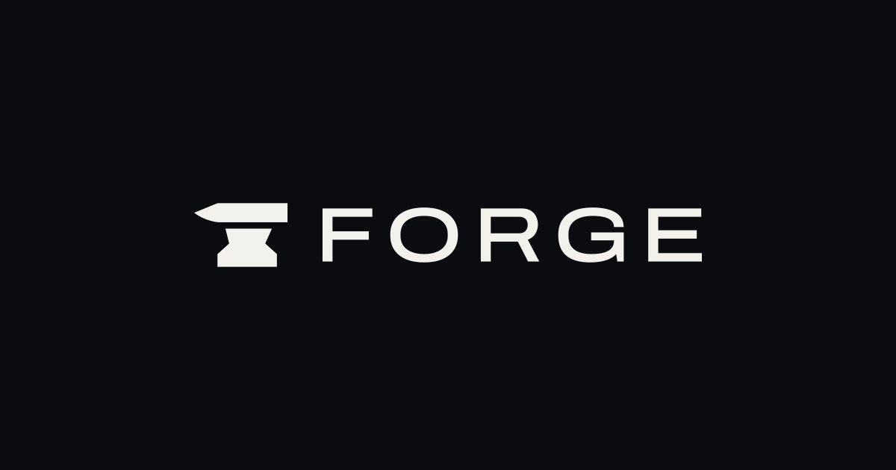

  

  <a href="https://forge.flashapp.me"><b>forge.flashapp.me</b></a> ·
  <a href="https://forge.flashapp.me/reserves"><b>See live reserves</b></a> ·
  <a href="https://github.com/ForgeReserve/forge-brand"><b>Brand assets</b></a>

Forge is a [Cashu](https://cashu.space) eCash mint that issues US dollars and bitcoin. Every unit is backed by a reserve, and Forge publishes the coverage every hour. Forge is operated by [Flash](https://getflash.io).

## How it works

1. **Pay in.** Pay a Lightning invoice for the dollars or bitcoin you want. Bitcoin can also arrive at an on-chain deposit address, and it counts after 1 confirmation.
2. **Hold.** The eCash lands in your Cashu wallet. The wallet's seed phrase restores it on a new phone.
3. **Spend.** Send it to anyone, pay a Lightning invoice, or withdraw bitcoin to an on-chain address.

To start, add `https://forge.flashapp.me` as a mint in any Cashu wallet, such as [Cashu.me](https://cashu.me), Minibits or Macadamia.

## Reserves

Dollar eCash is backed by a US dollar balance in the mint's Flash account. Bitcoin eCash is backed by the sats in Forge's own Lightning node, plus on-chain deposits waiting to be swept into it. Every hour the [reserves report](https://forge.flashapp.me/reserves) compares both reserves with the eCash outstanding, and [reserves.json](https://forge.flashapp.me/reserves.json) has the same figures for scripts. eCash at Forge carries no deposit insurance.

## Repositories

| Repository | What it holds |
| --- | --- |
| [**forge-brand**](https://github.com/ForgeReserve/forge-brand) | The Forge logo, symbol and app icon as SVG and PNG, with the brand helpers and the wordmark outliner. |

Forge runs [Nutshell](https://github.com/cashubtc/nutshell), with Lightning and on-chain payments through phoenixd. Forge's changes to Nutshell are offered upstream on [cashubtc/nutshell#1131](https://github.com/cashubtc/nutshell/pull/1131).

## Security

For a vulnerability report, open the affected repository's **Security** tab and choose **Report a vulnerability**, or write to [cashu@getflash.io](mailto:cashu@getflash.io). [SECURITY.md](https://github.com/ForgeReserve/.github/blob/main/SECURITY.md) has the details.

Mint info: [forge.flashapp.me/v1/info](https://forge.flashapp.me/v1/info) · Contact: [cashu@getflash.io](mailto:cashu@getflash.io)
